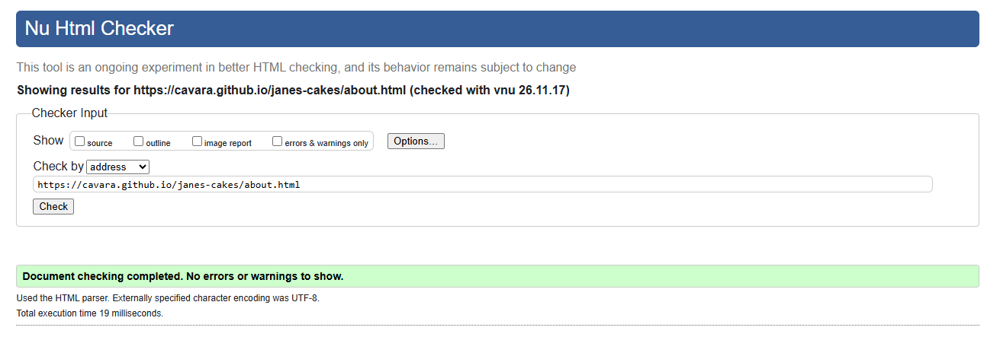
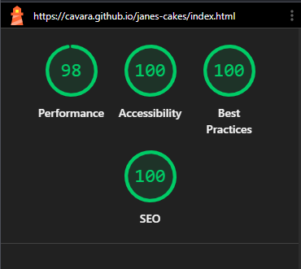
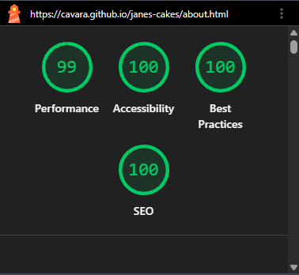
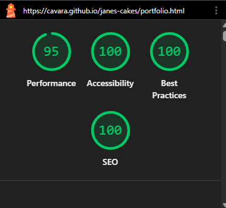

# Jane's Cakes

**Live site:** [https://cavara.github.io/janes-cakes/](https://cavara.github.io/janes-cakes/)

**Repository:** [https://github.com/cavara/janes-cakes](https://github.com/cavara/janes-cakes)


---

## Table of Contents

1. [Website Purpose](#website-purpose)
   - [Target Audience](#target-audience)
   - [User Stories](#user-stories)
2. [Features and User Benefits](#features-and-user-benefits)
3. [Technologies Used](#technologies-used)
4. [Deployment Procedure](#deployment-procedure)
5. [Screenshots](#screenshots)
6. [Testing and Validation](#testing-and-validation)
7. [Bugs / Errors](#bugs--errors)
8. [Credits and Attribution](#credits-and-attribution)
9. [Declaration of AI Use](#declaration-of-ai-use)
10. [Colour Palette](#colour-palette)
11. [Wireframes](#wireframes)
12. [Planned Future Updates](#planned-future-updates)

---

## Website Purpose

Jane's Cakes is a four-page website for Jane, a home baker based in Horley, Surrey, who makes custom cakes for birthdays, weddings, graduations, baby showers and other celebrations.

For the last five years Jane's business has grown through word of mouth with local customers. This website takes it online so that new customers across the UK can find her, see her work and order a cake.

The website aims to:

- **Showcase Jane's cakes** with a portfolio of her designs, so visitors can see the quality and variety of her work.
- **Build trust** by introducing Jane, her story and her approach to baking, so customers feel confident ordering from a small independent baker.
- **Generate enquiries** by making it quick and easy to get in touch, with an "Order a cake" button on every page and a simple enquiry form.

### Target Audience

- People planning a celebration (a birthday, wedding, graduation or baby shower) who want a cake that is personal and made to order.
- Customers who prefer a local, independent baker to a supermarket or chain.
- Existing customers who already know Jane and want an easy way to place a new order.

### User Stories

- As a first-time visitor, I want to understand straight away what Jane's Cakes offers, so I can decide if it suits my event.
- As a customer planning a celebration, I want to see examples of previous cakes, so I can judge the quality and get ideas for my own.
- As a potential customer, I want to learn about the person baking my cake, so I feel confident ordering.
- As a customer ready to order, I want a simple way to send my requirements and date, so I can book a cake quickly.
- As a mobile user, I want the site to be easy to read and navigate on my phone.

---

## Features and User Benefits

| Page | Features | User Benefit |
|------|----------|--------------|
| **Home** (`index.html`) | Welcome section with photo and introduction; cards for the four main occasions (Birthdays, Weddings, Graduations, Baby Showers); "Order a cake" button | Visitors can see within seconds what the business offers and which occasions it caters for, with a clear next step if they want to order. |
| **About** (`about.html`) | Jane's story, her experience and her approach to ingredients and baking; "Order a cake" button | Builds trust by putting a face and a story behind the business, showing customers they are buying from a skilled, caring baker. |
| **Portfolio** (`portfolio.html`) | Gallery of 12 cake styles in a responsive grid (4 per row on desktop, 2 on tablet, 1 on mobile), each with a short description | Lets customers browse real examples of Jane's work, compare styles and get inspiration before they get in touch. |
| **Contact** (`contact.html`) | Enquiry form (name, email, occasion, date needed, cake description); embedded Google Map; address and contact details; 48-hour response promise | Makes ordering simple: customers can send everything Jane needs in one go, see where she is based, and know when to expect a reply. On mobile the form appears first. |

**Site-wide features:**

| Feature | User Benefit |
|---------|--------------|
| Sticky navigation bar with logo, highlighted current page and "Order a cake" button | Visitors always know where they are and can move between pages or start an order from anywhere on the site. |
| Responsive design (Bootstrap 5) with a collapsing hamburger menu on small screens | The site is easy to use on phones, tablets and desktops. |
| Consistent brand colours and logo across every page, plus a logo favicon | A professional, recognisable look that matches Jane's brand and builds confidence. |
| Footer call to action ("Got an idea for a cake...? Get in touch") | Gives visitors one more prompt to get in touch when they reach the end of a page. |
| Accessibility: descriptive alt text, logical heading order, colour contrast that meets WCAG AA | The site can be used by people with screen readers or visual impairments (Lighthouse Accessibility score of 100 on every page). |
| Optimised images with lazy loading | Pages load quickly, even on mobile data (Lighthouse Performance 96–99). |

---

## Technologies Used

- HTML5
- CSS3 (`assets/css/style.css`)
- [Bootstrap 5.3.3](https://getbootstrap.com/)
- Google Maps embed
- Git and GitHub
- GitHub Pages (hosting)
- VS Code

---

## Deployment Procedure

The site is deployed with GitHub Pages:

1. Push the latest code to the `main` branch of the [repository](https://github.com/cavara/janes-cakes).
2. On GitHub, go to **Settings → Pages**.
3. Under **Source**, select **Deploy from a branch**.
4. Choose the `main` branch and the `/ (root)` folder, then click **Save**.
5. After a minute or two the live site is available at the link at the top of this README.

**To run locally:**

```bash
git clone https://github.com/cavara/janes-cakes.git
cd janes-cakes
```

Then open `index.html` in a browser (or use the VS Code Live Server extension).

<!-- TODO: add any extra steps or screenshots of the deployment settings -->

---

## Screenshots

Full-page screenshots of every page, taken with Chrome DevTools. Click an image to view it full size.

| Page | Desktop | Mobile |
|------|---------|--------|
| Home |  |  |
| About |  |  |
| Portfolio |  |  |
| Contact |  |  |

---

## Testing and Validation

### HTML Validation ([W3C Markup Validator](https://validator.w3.org/))

| Page | Result | Screenshot |
|------|--------|------------|
| Home | ✅ Pass |  |
| About | ✅ Pass |  |
| Portfolio | ✅ Pass |  |
| Contact | ✅ Pass |  |

### CSS Validation ([W3C Jigsaw](https://jigsaw.w3.org/css-validator/))

| File | Result | Screenshot |
|------|--------|------------|
| `style.css` | ✅ Pass – no errors found (CSS level 3 + SVG) |  |

### Lighthouse (Chrome DevTools, mobile mode)

All pages were tested in an Incognito window to stop browser extensions affecting the scores.

| Page | Performance | Accessibility | Best Practices | SEO | Screenshot |
|------|-------------|---------------|----------------|-----|------------|
| Home | 98 | 100 | 100 | 100 |  |
| About | 99 | 100 | 100 | 100 |  |
| Portfolio | 96 | 100 | 100 | 100 |  |
| Contact | 99 | 100 | 100 | 100 |  |

The home page originally scored 58 for Performance. This was improved to 98 by compressing the main photo and lazy-loading images further down the page (see [Bugs / Errors](#bugs--errors)).

------|-------------|---------------|----------------|-----|------------|
| Home | | | | | <!--  --> |
| About | | | | | <!--  --> |
| Portfolio | | | | | <!--  --> |
| Contact | | | | | <!--  --> |

---

## Bugs / Errors

| Bug / Error | Cause | Fix | Status |
|-------------|-------|-----|--------|
| W3C HTML validator flagged image filenames as illegal (e.g. `images (5).jpg`) | Spaces and brackets are not allowed in a URL path | Renamed all images to lowercase hyphenated names (e.g. `floral-drip-cake.jpg`) and updated every `src` | Fixed |
| W3C HTML validator: "no heading with a computed level of 1" | Each page's main heading used `<h2>` | Changed the main heading on each page to `<h1>`, keeping the `display-5` class so it looks the same | Fixed |
| W3C HTML validator: "Trailing slash on void elements" info messages | Tags such as `` and `<meta ... />` were written with a closing slash | Removed the trailing slashes from all void elements | Fixed |
| Stray `</style>` in `index.html` and an extra `</section>` in `contact.html` | Leftover closing tags with no matching opening tag | Deleted the unmatched tags | Fixed |
| Navbar showed "Home" as the active page on every page | The navbar was copied between pages without updating the `active` class | Moved `active` and `aria-current="page"` to the correct link on each page | Fixed |
| Logo displayed at full size and stretched the navbar | The `.logo` class had no CSS rule | Added `.logo { height: 50px; width: auto; }` to `style.css` | Fixed |
| Contact page form, button and logo had no custom styling | `contact.html` did not link to `style.css`, and Bootstrap was linked twice | Added the `style.css` link after Bootstrap and removed the duplicate Bootstrap link | Fixed |
| Mobile hamburger menu missing and stray text in the navbar | The opening `<button class="navbar-toggler"` line was deleted by accident while editing | Restored the missing line | Fixed |
| W3C HTML validator: "h3 follows h1, skipping 1 heading level" | Sub-headings and card titles used `<h3>` directly under the page's `<h1>` | Changed them to `<h2>` and added Bootstrap's `h3` / `h5` classes so they look the same | Fixed |
| Lighthouse Performance score of 58 on the home page (mobile) | The main home page photo was a 3.9 MB, 1264×1264 PNG | Resized to 800×800 and converted to WebP (81 KB, about 98% smaller) | Fixed |
| Lighthouse SEO and Best Practices points lost | Pages had no meta description, and the missing favicon caused a console error | Added a meta description to each page and linked the logo as the favicon | Fixed |
| Lighthouse Accessibility score of 96 on the contact page: "insufficient contrast ratio" | White text on the light pink `.btn-cake` button (`#d98a9c`) had a contrast ratio of only 2.6:1; WCAG AA needs 4.5:1 | Changed the button to a deeper pink (`#b5566e`, 4.6:1) and the hover colour to `#9c3f58` | Fixed |

---

## Credits and Attribution

### Code
- [Bootstrap 5.3.3](https://getbootstrap.com/) – layout, navbar and card components
- <!-- TODO: any other code snippets or tutorials used -->

### Images
| Image | Source |
|-------|--------|
| <!-- e.g. sponge.jpg --> | <!-- URL / author --> |
| <!-- e.g. chocolate.jpg --> | |
| <!-- e.g. carrot-cake-beauty-4.webp --> | |
| <!-- e.g. frosted.jpg --> | |
| <!-- e.g. Jane.jpg --> | |

### Maps / Media
- Map embedded from [Google Maps](https://www.google.com/maps)

---

## Declaration of AI Use

I used **Claude** (Anthropic's AI assistant) during this project as a coding assistant and tutor. I built the original four pages myself, and I reviewed, tested and approved every change before committing it.

**What AI was used for:**

| Area | How AI helped |
|------|---------------|
| README | Creating the README structure from the bootcamp checklist, and drafting the website purpose, user stories, feature benefits and bugs sections, which I then reviewed and edited |
| Validation | Explaining and fixing W3C HTML validator errors (spaces in image filenames, heading order, trailing slashes) |
| Performance and accessibility | Identifying the oversized home page image, compressing it to WebP, adding lazy loading, meta descriptions and a favicon, and fixing a colour contrast issue flagged by Lighthouse |
| Process | Explaining how to deploy with GitHub Pages, take full-page screenshots in Chrome DevTools, and run the HTML, CSS and Lighthouse tests |

AI also suggested some styling and layout changes, which I reviewed and adapted.

<!-- TODO: add any other AI tools you used, e.g. an image generator for photos, or AI help with the original page content or logo. Delete this comment if there are none. -->

**What I did myself:**

- Planned the site and wrote the original HTML pages and CSS
- Chose the content, images and branding for Jane's Cakes
- Ran all the validation and Lighthouse tests and took the screenshots
- Checked every AI suggestion in the browser before keeping it, and made the final decisions about what went into the site

**What I learned:** <!-- TODO: one or two sentences in your own words, e.g. "how Bootstrap's grid works, why heading order matters for screen readers, and how image size affects page speed." -->

---

## Colour Palette

<!-- TODO: add palette image, e.g. generated with https://coolors.co -->
<!--  -->

| Colour | Hex | Used for |
|--------|-----|----------|
| | | |

---

## Wireframes

<!-- TODO: add wireframes (e.g. Balsamiq / Figma) -->
<!--  -->

---

## Planned Future Updates

- <!-- e.g. Online ordering and payment -->
- <!-- e.g. Customer reviews / testimonials -->
- <!-- e.g. Working back-end for the contact form -->
