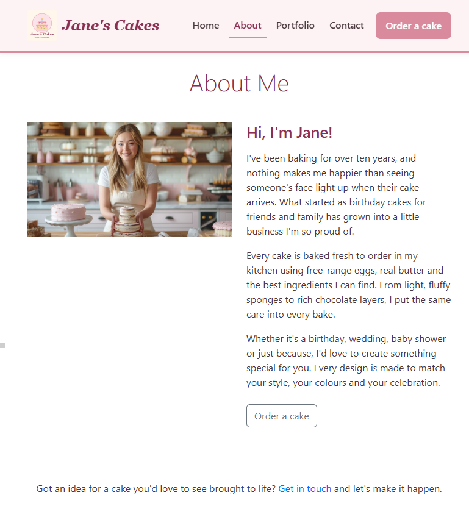
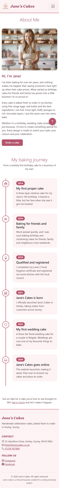
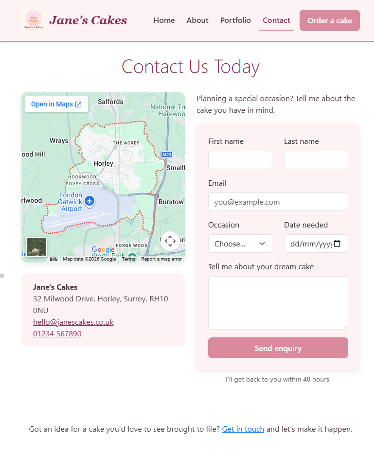
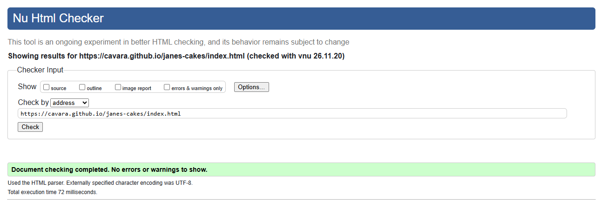
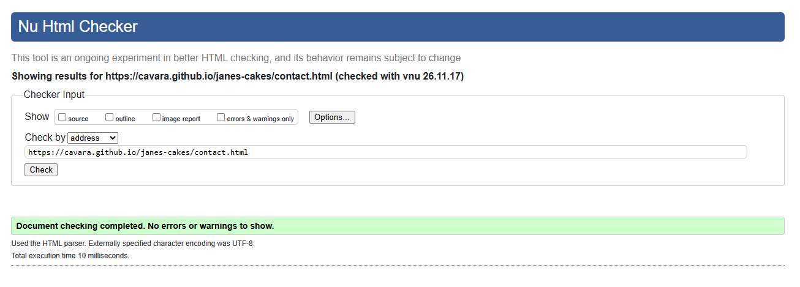
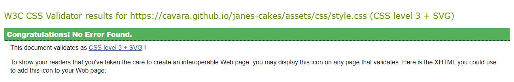

# Jane's Cakes

**Live site:** [https://cavara.github.io/janes-cakes/](https://cavara.github.io/janes-cakes/)

**Repository:** [https://github.com/cavara/janes-cakes](https://github.com/cavara/janes-cakes)


---

## Table of Contents

1. [Website Purpose](#website-purpose)
2. [Features and User Benefits](#features-and-user-benefits)
3. [Technologies Used](#technologies-used)
4. [Deployment Procedure](#deployment-procedure)
5. [Screenshots](#screenshots)
6. [Testing and Validation](#testing-and-validation)
7. [Bugs / Errors](#bugs--errors)
8. [Credits and Attribution](#credits-and-attribution)
9. [Declaration of AI Use](#declaration-of-ai-use)
10. [Colour Palette](#colour-palette)
11. [Wireframes](#wireframes)
12. [Planned Future Updates](#planned-future-updates)

---

## Website Purpose

Jane's Cakes is a four-page website for a home baker offering custom cakes for birthdays, weddings, graduations and baby showers.

<!-- TODO: Describe who the site is for and what it aims to achieve (e.g. showcase Jane's work, build trust, generate enquiries). -->

---

## Features and User Benefits

| Page | Features | User Benefit |
|------|----------|--------------|
| **Home** (`index.html`) | Navigation bar, welcome section, cards for Birthdays, Weddings, Graduations and Baby Showers, call-to-action link to Contact | <!-- TODO --> |
| **About** (`about.html`) | Introduction to Jane, her story and photo, link to Contact | <!-- TODO --> |
| **Portfolio** (`portfolio.html`) | Gallery cards for Sponge, Chocolate, Carrot and Frosted cakes | <!-- TODO --> |
| **Contact** (`contact.html`) | Contact form, embedded Google Map (Horley) | <!-- TODO --> |

**Site-wide features:**
- Responsive Bootstrap navigation bar on every page
- Mobile-friendly layout
- <!-- TODO: add footer / social links / other shared features -->

---

## Technologies Used

- HTML5
- CSS3 (`assets/css/style.css`)
- [Bootstrap 5.3.3](https://getbootstrap.com/)
- Google Maps embed
- Git and GitHub
- GitHub Pages (hosting)
- VS Code

---

## Deployment Procedure

The site is deployed with GitHub Pages:

1. Push the latest code to the `main` branch of the [repository](https://github.com/cavara/janes-cakes).
2. On GitHub, go to **Settings → Pages**.
3. Under **Source**, select **Deploy from a branch**.
4. Choose the `main` branch and the `/ (root)` folder, then click **Save**.
5. After a minute or two the live site is available at the link at the top of this README.

**To run locally:**

```bash
git clone https://github.com/cavara/janes-cakes.git
cd janes-cakes
```

Then open `index.html` in a browser (or use the VS Code Live Server extension).

<!-- TODO: add any extra steps or screenshots of the deployment settings -->

---

## Screenshots

Full-page screenshots of every page, taken with Chrome DevTools. Click an image to view it full size.

| Page | Desktop | Mobile |
|------|---------|--------|
| Home |  |  |
| About |  |  |
| Portfolio |  |  |
| Contact |  |  |

---

## Testing and Validation

### HTML Validation ([W3C Markup Validator](https://validator.w3.org/))

| Page | Result | Screenshot |
|------|--------|------------|
| Home | <!-- Pass / Fail --> | <!--  --> |
| About | <!-- Pass / Fail --> | <!--  --> |
| Portfolio | <!-- Pass / Fail --> | <!--  --> |
| Contact | <!-- Pass / Fail --> | <!--  --> |

### CSS Validation ([W3C Jigsaw](https://jigsaw.w3.org/css-validator/))

| File | Result | Screenshot |
|------|--------|------------|
| `style.css` | <!-- Pass / Fail --> | <!--  --> |

### Lighthouse Performance

| Page | Performance | Accessibility | Best Practices | SEO | Screenshot |
|------|-------------|---------------|----------------|-----|------------|
| Home | | | | | <!--  --> |
| About | | | | | <!--  --> |
| Portfolio | | | | | <!--  --> |
| Contact | | | | | <!--  --> |

---

## Bugs / Errors

| Bug / Error | Cause | Fix | Status |
|-------------|-------|-----|--------|
| <!-- e.g. Nav "active" class shows Home on every page --> | | | <!-- Fixed / Open --> |

---

## Credits and Attribution

### Code
- [Bootstrap 5.3.3](https://getbootstrap.com/) – layout, navbar and card components
- <!-- TODO: any other code snippets or tutorials used -->

### Images
| Image | Source |
|-------|--------|
| <!-- e.g. sponge.jpg --> | <!-- URL / author --> |
| <!-- e.g. chocolate.jpg --> | |
| <!-- e.g. carrot-cake-beauty-4.webp --> | |
| <!-- e.g. frosted.jpg --> | |
| <!-- e.g. Jane.jpg --> | |

### Maps / Media
- Map embedded from [Google Maps](https://www.google.com/maps)

---

## Declaration of AI Use

<!-- TODO: State which AI tools were used, what for (e.g. README structure, debugging, content drafting), and what you wrote or checked yourself. -->

---

## Colour Palette

<!-- TODO: add palette image, e.g. generated with https://coolors.co -->
<!--  -->

| Colour | Hex | Used for |
|--------|-----|----------|
| | | |

---

## Wireframes

<!-- TODO: add wireframes (e.g. Balsamiq / Figma) -->
<!--  -->

---

## Planned Future Updates

- <!-- e.g. Online ordering and payment -->
- <!-- e.g. Customer reviews / testimonials -->
- <!-- e.g. Working back-end for the contact form -->
