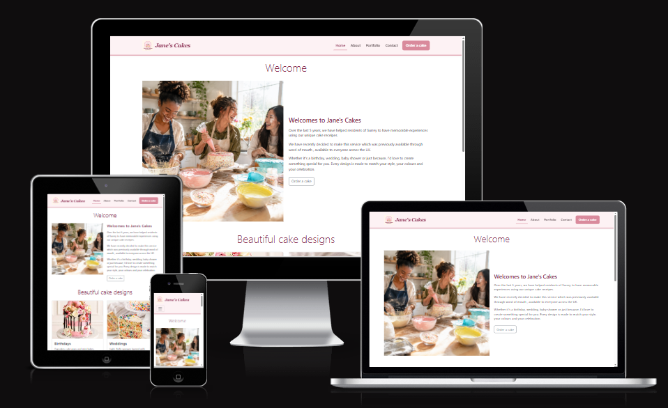
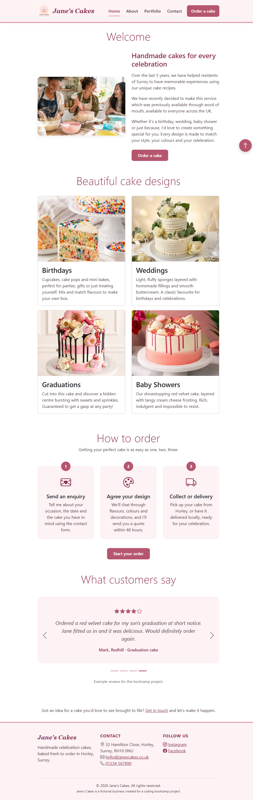
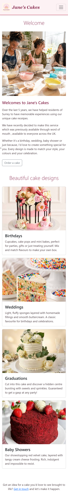
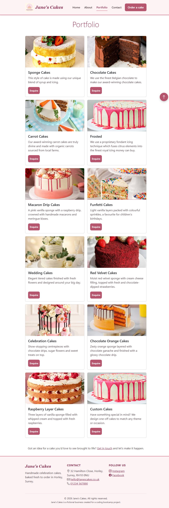
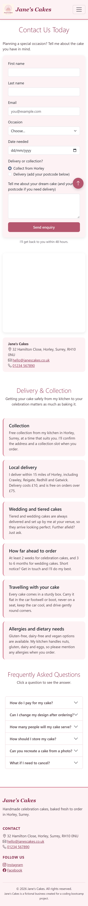
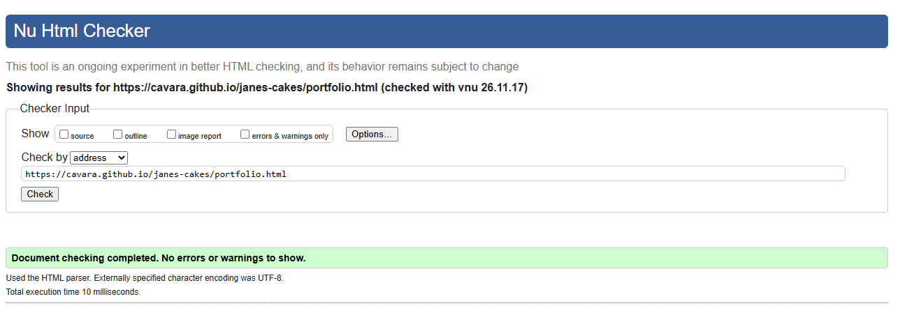
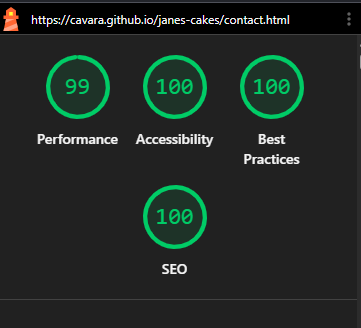
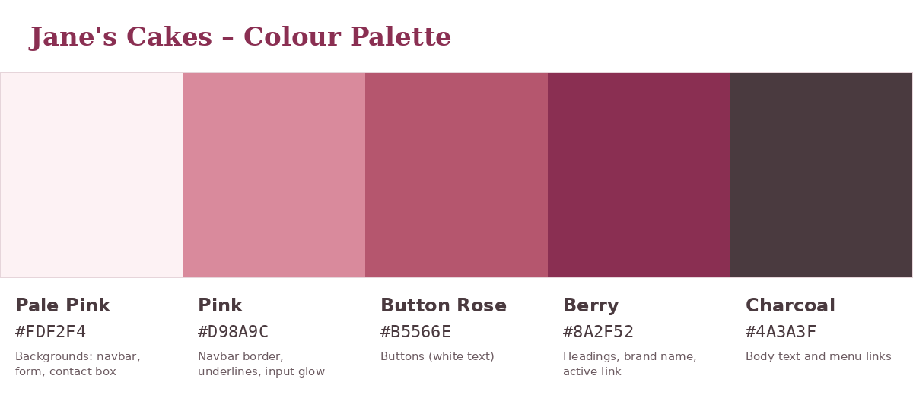

# Jane's Cakes

**Live site:** [https://cavara.github.io/janes-cakes/](https://cavara.github.io/janes-cakes/)

**Repository:** [https://github.com/cavara/janes-cakes](https://github.com/cavara/janes-cakes)



---

## Table of Contents

1. [Website Purpose](#website-purpose)
2. [Features and User Benefits](#features-and-user-benefits)
3. [Technologies Used](#technologies-used)
4. [Deployment Procedure](#deployment-procedure)
5. [Screenshots](#screenshots)
6. [Testing and Validation](#testing-and-validation)
7. [Bugs / Errors](#bugs--errors)
8. [Credits and Attribution](#credits-and-attribution)
9. [Declaration of AI Use](#declaration-of-ai-use)
10. [Colour Palette](#colour-palette)
11. [Wireframes](#wireframes)
12. [Planned Future Updates](#planned-future-updates)

---

## Website Purpose

Jane's Cakes is a four-page website for a home baker offering custom cakes for birthdays, weddings, graduations and baby showers.

<!-- TODO: Describe who the site is for and what it aims to achieve (e.g. showcase Jane's work, build trust, generate enquiries). -->

---

## Features and User Benefits

| Page | Features | User Benefit |
|------|----------|--------------|
| **Home** (`index.html`) | Navigation bar, welcome section, cards for Birthdays, Weddings, Graduations and Baby Showers, call-to-action link to Contact | <!-- TODO --> |
| **About** (`about.html`) | Introduction to Jane, her story and photo, link to Contact | <!-- TODO --> |
| **Portfolio** (`portfolio.html`) | Gallery cards for Sponge, Chocolate, Carrot and Frosted cakes | <!-- TODO --> |
| **Contact** (`contact.html`) | Contact form, embedded Google Map (Horley) | <!-- TODO --> |

**Site-wide features:**
- Responsive Bootstrap navigation bar on every page
- Mobile-friendly layout
- <!-- TODO: add footer / social links / other shared features -->

---

## Technologies Used

- HTML5
- CSS3 (`assets/css/style.css`)
- [Bootstrap 5.3.3](https://getbootstrap.com/)
- Google Maps embed
- Git and GitHub
- GitHub Pages (hosting)
- VS Code

---

## Deployment Procedure

The site is deployed with GitHub Pages:

1. Push the latest code to the `main` branch of the [repository](https://github.com/cavara/janes-cakes).
2. On GitHub, go to **Settings → Pages**.
3. Under **Source**, select **Deploy from a branch**.
4. Choose the `main` branch and the `/ (root)` folder, then click **Save**.
5. After a minute or two the live site is available at the link at the top of this README.

**To run locally:**

```bash
git clone https://github.com/cavara/janes-cakes.git
cd janes-cakes
```

Then open `index.html` in a browser (or use the VS Code Live Server extension).

<!-- TODO: add any extra steps or screenshots of the deployment settings -->

---

## Screenshots

Full-page screenshots of every page, taken with Chrome DevTools. Click an image to view it full size.

| Page | Desktop | Mobile |
|------|---------|--------|
| Home |  |  |
| About |  |  |
| Portfolio |  |  |
| Contact |  |  |

---

## Testing and Validation

### HTML Validation ([W3C Markup Validator](https://validator.w3.org/))

| Page | Result | Screenshot |
|------|--------|------------|
| Home | ✅ Pass |  |
| About | ✅ Pass |  |
| Portfolio | ✅ Pass |  |
| Contact | ✅ Pass |  |

### CSS Validation ([W3C Jigsaw](https://jigsaw.w3.org/css-validator/))

| File | Result | Screenshot |
|------|--------|------------|
| `style.css` | ✅ Pass – no errors found (CSS level 3 + SVG) |  |

### Lighthouse Performance

| Page | Performance | Accessibility | Best Practices | SEO | Screenshot |
|------|-------------|---------------|----------------|-----|------------|
| Home | | | | | <!--  --> |
| About | | | | | <!--  --> |
| Portfolio | | | | | <!--  --> |
| Contact | | | | | <!--  --> |

---

## Bugs / Errors

| Bug / Error | Cause | Fix | Status |
|-------------|-------|-----|--------|
| W3C HTML validator flagged image filenames as illegal (e.g. `images (5).jpg`) | Spaces and brackets are not allowed in a URL path | Renamed all images to lowercase hyphenated names (e.g. `floral-drip-cake.jpg`) and updated every `src` | Fixed |
| W3C HTML validator: "no heading with a computed level of 1" | Each page's main heading used `<h2>` | Changed the main heading on each page to `<h1>`, keeping the `display-5` class so it looks the same | Fixed |
| W3C HTML validator: "Trailing slash on void elements" info messages | Tags such as `` and `<meta ... />` were written with a closing slash | Removed the trailing slashes from all void elements | Fixed |
| Stray `</style>` in `index.html` and an extra `</section>` in `contact.html` | Leftover closing tags with no matching opening tag | Deleted the unmatched tags | Fixed |
| Navbar showed "Home" as the active page on every page | The navbar was copied between pages without updating the `active` class | Moved `active` and `aria-current="page"` to the correct link on each page | Fixed |
| Logo displayed at full size and stretched the navbar | The `.logo` class had no CSS rule | Added `.logo { height: 50px; width: auto; }` to `style.css` | Fixed |
| Contact page form, button and logo had no custom styling | `contact.html` did not link to `style.css`, and Bootstrap was linked twice | Added the `style.css` link after Bootstrap and removed the duplicate Bootstrap link | Fixed |
| Mobile hamburger menu missing and stray text in the navbar | The opening `<button class="navbar-toggler"` line was deleted by accident while editing | Restored the missing line | Fixed |
| W3C HTML validator: "h3 follows h1, skipping 1 heading level" | Sub-headings and card titles used `<h3>` directly under the page's `<h1>` | Changed them to `<h2>` and added Bootstrap's `h3` / `h5` classes so they look the same | Fixed |
| Lighthouse Performance score of 58 on the home page (mobile) | The main home page photo was a 3.9 MB, 1264×1264 PNG | Resized to 800×800 and converted to WebP (81 KB, about 98% smaller) | Fixed |
| Lighthouse SEO and Best Practices points lost | Pages had no meta description, and the missing favicon caused a console error | Added a meta description to each page and linked the logo as the favicon | Fixed |

---

## Credits and Attribution

### Code
- [Bootstrap 5.3.3](https://getbootstrap.com/) – layout, navbar and card components
- <!-- TODO: any other code snippets or tutorials used -->

### Images
| Image | Source |
|-------|--------|
| <!-- e.g. sponge.jpg --> | <!-- URL / author --> |
| <!-- e.g. chocolate.jpg --> | |
| <!-- e.g. carrot-cake-beauty-4.webp --> | |
| <!-- e.g. frosted.jpg --> | |
| <!-- e.g. Jane.jpg --> | |

### Maps / Media
- Map embedded from [Google Maps](https://www.google.com/maps)

---

## Declaration of AI Use

<!-- TODO: State which AI tools were used, what for (e.g. README structure, debugging, content drafting), and what you wrote or checked yourself. -->

---

## Colour Palette

<!-- TODO: add palette image, e.g. generated with https://coolors.co -->
<!--  -->

| Colour | Hex | Used for |
|--------|-----|----------|
| | | |

---

## Wireframes

<!-- TODO: add wireframes (e.g. Balsamiq / Figma) -->
<!--  -->

---

## Planned Future Updates

- <!-- e.g. Online ordering and payment -->
- <!-- e.g. Customer reviews / testimonials -->
- <!-- e.g. Working back-end for the contact form -->
